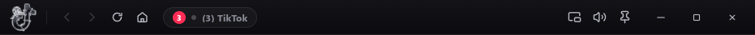
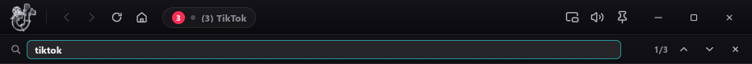

<div align="center">
  
</div>

<div align="center">
  <a href="https://github.com/octomood/tiktok-octo/actions/workflows/ci.yml"></a>
  <a href="https://github.com/octomood/tiktok-octo/releases"></a>
  <a href="LICENSE"></a>
  
  
  
</div>

<br />

<div align="center">
  <a href="README.md">English</a> &nbsp;·&nbsp; <b>Русский</b>
</div>

<br />

**TikTok octo** — неофициальный десктоп-клиент TikTok: официальный сайт, вход
и всё остальное, завёрнутые в тонкую нативную оболочку на Electron. Ни лишних
вкладок, ни адресной строки, ни браузерной мишуры — только своя полоса заголовка
высотой 44 пикселя, плавающее окно для видео и несколько горячих клавиш, которые
имеют смысл на десктопе.

> **Почему оболочка, а не «свой клиент»?**
> TikTok не выдаёт сторонним приложениям доступ к ленте, рекомендациям и
> публикации — публичного API для этого нет. Единственный путь, который не ломает
> правила, — показать их же веб-клиент в нативном окне. Так и сделано: никакого
> парсинга приватных запросов, подмены подписи и обхода защит. Браузер в форме
> приложения.

<div align="center">
  
  <br />
  <sub><i>Весь интерфейс: знак бренда, навигация, непрочитанные, состояние страницы, кнопки окна.</i></sub>
</div>

## Что внутри

|                                     |                                                                                                                                                                             |
| :---------------------------------- | :-------------------------------------------------------------------------------------------------------------------------------------------------------------------------- |
| **🪟&nbsp; Своя полоса заголовка**  | Назад / вперёд / обновить / главная, живая плашка страницы, счётчик непрочитанных, системные кнопки окна. Перетаскивание и двойной клик — развернуть — работают сами собой. |
| **🔐&nbsp; Настоящий логин**        | Постоянная сессия `persist:octo-tiktok` на диске: вход сохраняется между запусками. OAuth-окна Google, Apple, Facebook и X открываются поверх приложения.                   |
| **🔎&nbsp; Поиск по странице**      | <kbd>Ctrl</kbd>+<kbd>F</kbd> открывает компактную панель со счётчиком `1/3`. Страница поджимается вниз, а не прячется под панелью; <kbd>Esc</kbd> закрывает.                |
| **🎬&nbsp; Картинка в картинке**    | Текущее видео уходит в плавающее окно поверх всех программ. Кнопка на панели или <kbd>Ctrl</kbd>+<kbd>Shift</kbd>+<kbd>P</kbd>.                                             |
| **📌&nbsp; Поверх всех окон**       | Лента остаётся сверху, пока вы делаете вид, что работаете. Режим переживает перезапуск.                                                                                     |
| **🔇&nbsp; Тихий режим**            | Один клик, <kbd>Ctrl</kbd>+<kbd>Shift</kbd>+<kbd>M</kbd> или медиа-клавиша. Без перезагрузки и потери состояния.                                                            |
| **🗂&nbsp; Трей**                    | Скрыть окно, звук, «поверх всех», PiP — или включить «закрывать в трей» и слушать дальше.                                                                                   |
| **⬇️&nbsp; Загрузки**               | Файл сохраняется через системный диалог, прогресс идёт в полосе заголовка, результат — тостом.                                                                              |
| **🔄&nbsp; Самообновление**         | Собранная версия проверяет GitHub Releases и предлагает перезапуститься, когда обновление готово.                                                                           |
| **🔍&nbsp; Масштаб как в браузере** | Ступени Chromium от 50 до 300 %, запоминаются между запусками.                                                                                                              |
| **🌍&nbsp; Вежливые ссылки**        | Всё, что не `tiktok.com`, открывается в системном браузере. Ссылки TikTok с `target=_blank` остаются в приложении.                                                          |
| **🧠&nbsp; Всё помнит**             | Геометрию и развёрнутость окна, масштаб, звук, «поверх всех» и последнюю страницу.                                                                                          |
| **🧯&nbsp; Не падает молча**        | Неудачная загрузка повторяется с backoff, упавший рендерер поднимается, зависшая страница честно сообщает об этом.                                                          |
| **⛶&nbsp; Настоящий полный экран**  | Видео занимает всё окно, полоса заголовка уходит с дороги.                                                                                                                  |

<div align="center">
  
  <br />
  <sub><i>Поиск по странице: контент поджимается, а не перекрывается.</i></sub>
</div>

## Горячие клавиши

| Клавиши                                                                                              | Действие                                     |
| :--------------------------------------------------------------------------------------------------- | :------------------------------------------- |
| <kbd>Alt</kbd>+<kbd>←</kbd> / <kbd>Alt</kbd>+<kbd>→</kbd>                                            | Назад / вперёд по истории                    |
| <kbd>Ctrl</kbd>+<kbd>F</kbd>                                                                         | Поиск по странице                            |
| <kbd>Enter</kbd> / <kbd>Shift</kbd>+<kbd>Enter</kbd>, <kbd>F3</kbd> / <kbd>Shift</kbd>+<kbd>F3</kbd> | Следующее / предыдущее совпадение            |
| <kbd>Esc</kbd>                                                                                       | Закрыть поиск, затем выйти из полного экрана |
| <kbd>Ctrl</kbd>+<kbd>R</kbd>                                                                         | Обновить                                     |
| <kbd>Ctrl</kbd>+<kbd>Shift</kbd>+<kbd>R</kbd>                                                        | Обновить без кэша                            |
| <kbd>F5</kbd>                                                                                        | Обновить                                     |
| <kbd>Ctrl</kbd>+<kbd>=</kbd> / <kbd>Ctrl</kbd>+<kbd>-</kbd> / <kbd>Ctrl</kbd>+<kbd>0</kbd>           | Масштаб: крупнее / мельче / 100 %            |
| <kbd>Ctrl</kbd>+<kbd>Shift</kbd>+<kbd>M</kbd>                                                        | Звук вкл/выкл                                |
| <kbd>Ctrl</kbd>+<kbd>Shift</kbd>+<kbd>P</kbd>                                                        | Картинка в картинке                          |
| <kbd>Ctrl</kbd>+<kbd>Shift</kbd>+<kbd>O</kbd>                                                        | Поверх всех окон                             |
| <kbd>Ctrl</kbd>+<kbd>Shift</kbd>+<kbd>I</kbd>                                                        | Инструменты разработчика                     |
| <kbd>Ctrl</kbd>+<kbd>W</kbd> / <kbd>Ctrl</kbd>+<kbd>Q</kbd>                                          | Закрыть окно / выйти                         |
| <kbd>F11</kbd>                                                                                       | Полный экран                                 |
| Медиа-клавиши                                                                                        | Играть / пауза, стоп (звук)                  |

На macOS вместо <kbd>Ctrl</kbd> — <kbd>Cmd</kbd>.

## Быстрый старт

```bash
git clone https://github.com/octomood/tiktok-octo.git
cd tiktok-octo

npm ci

# npm 12+ блокирует install-скрипты, из-за чего бинарник Electron не скачивается:
node node_modules/electron/install.js

npm start        # запуск
npm run dev      # запуск с логами страницы
```

## Сборка и релизы

```bash
npm run dist:linux   # AppImage + deb
npm run dist:win     # NSIS-установщик + portable
npm run dist:mac     # dmg
```

Готовые файлы появятся в `dist/`. Иконка — `build/icon.png`
(исходник `build/icon.svg`, пересобирается через `rsvg-convert`).

Пуш тега `v*` запускает `.github/workflows/release.yml`: собираются все три
платформы, артефакты уходят в GitHub Releases — оттуда же их читает встроенный
апдейтер.

## Разработка

```bash
npm run lint          # eslint
npm run format:check  # prettier
npm test              # дымовой тест Playwright на живом Electron
```

Тест поднимает приложение с временным профилем и `about:blank` вместо главной,
поэтому не трогает вашу сессию и не зависит от сети. В CI он выполняется под
`xvfb`.

```
src/
  main/
    main.js        жизненный цикл, IPC, медиа-клавиши, single-instance
    app-context.js общее состояние окна и мост main → полоса заголовка
    window.js      BrowserWindow, геометрия, «закрывать в трей»
    view.js        WebContentsView с сайтом, история, ретраи, полный экран
    session.js     persistent-сессия, разрешения, загрузки
    store.js       JSON-состояние в userData
    commands.js    таблица команд для кнопок и шорткатов
    find.js        поиск по странице
    shortcuts.js   обработка before-input-event
    menu.js        меню приложения и контекстное меню
    tray.js        иконка в трее и её меню
    updates.js     electron-updater
    hardening.js   защита popup'ов и навигации
    links.js       «открыть в системном браузере»
    shared.js      константы и предикаты URL
    preload.js     мост window.octo для полосы заголовка
  renderer/
    index.html     разметка полосы заголовка и панели поиска
    styles.css     их оформление
    titlebar.js    состояние, тосты, клавиатура
    assets/
      tiktok-octo.png  знак бренда (кроп и очистка tiktok-octo.jpg)
test/
  smoke.spec.js  дымовой тест Playwright
build/
  icon.svg / icon.png / entitlements.mac.plist
```

Ключевое решение: сайт живёт не в `<webview>` и не в `<iframe>`, а в отдельном
`WebContentsView`, прижатом под полосой заголовка. Свой интерфейс — обычная
страница Electron, контент TikTok — изолированный процесс без preload, без Node
и с `sandbox: true`. Сайт не может дотянуться до нашего интерфейса, а мы
управляем им только через `webContents`. Разрешения — явный список (камера,
микрофон, уведомления, полный экран, запись в буфер, pointer lock), и только для
`tiktok.com`; всё остальное уходит в системный браузер.

Мелочи, которые пришлось учесть:

- **User-Agent** собирается из версии Chromium без токена `Electron/…` — иначе
  часть CDN и страниц ведёт себя иначе, чем в обычном Chrome.
- **История навигации** считается по индексам, а не через
  `navigationHistory.canGoBack()`. SPA-роутер TikTok помечает записи как
  skippable, из-за чего встроенные `canGoBack()`/`goBack()` врут и молча ничего
  не делают. Шаг выполняется через `goToIndex()`.
- **Прямой заход в профиль** TikTok сопровождает `location.replace`, поэтому
  история схлопывается до одной записи и «Назад» честно недоступна — это
  поведение сайта, а не бага клиента.
- **Панель поиска** живёт в нашем renderer, а сам поиск — это
  `webContents.findInPage()`. Renderer сообщает свою реальную высоту по IPC,
  поэтому view с сайтом сдвигается вниз, а не оказывается под панелью.
- **HTML-fullscreen** обрабатывается отдельно: по событию `enter-html-full-screen`
  view растягивается на всё окно, а полоса заголовка скрывается.

## Ограничения

- Под **Wayland** композитор сам решает, где и какого размера будет окно, поэтому
  сохранённая геометрия может игнорироваться; под X11, Windows и macOS всё
  работает как обычно.
- **PiP** и **глобальные медиа-клавиши** зависят от портала рабочего стола; на
  некоторых сборках Wayland они могут не работать (приложение сообщает об этом).
- **Трей** на Linux требует StatusNotifier; без него приложение просто работает
  без иконки.
- **Бейдж непрочитанных** появляется там, где его поддерживает система (док
  macOS, лончер Unity); число берётся из заголовка страницы, без приватных
  запросов.
- **Автообновление** работает только для собранных версий, опубликованных через
  GitHub Releases.
- Реклама, рекомендации, ограничения аккаунта — всё как в вебе, клиент их не
  трогает.

## Правовое

Код приложения — MIT. Сам TikTok, его логотипы и контент принадлежат TikTok Ltd.
Приложение не аффилировано с TikTok, не модифицирует их трафик и не обходит
защиты: это браузер в форме окна. Публиковать сборки в магазинах под чужим
именем и логотипом нельзя — для личного использования проблем нет.

<div align="center">
  <sub>Сделано из стекла, градиентов и <code>WebContentsView</code>.</sub>
</div>
